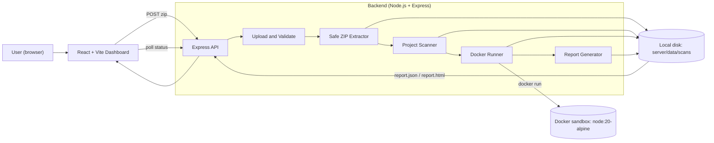
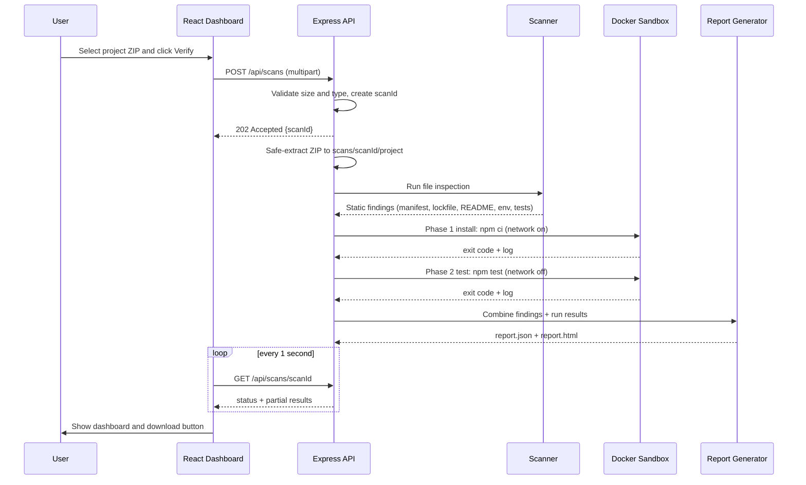

# BuildProof — Architecture

**Project Handover Readiness Checker**
Code Yudh Hackathon · Chandigarh University · Final round: 27 October 2026

> **Status: PLANNED.** Nothing in this document has been built or tested yet. Every component, check and metric below is a design, not a result. As we build, update the status tracker in Section 17.

---

## 1. What BuildProof is

BuildProof answers one question: **"Can someone else set this project up and run it?"**

A user uploads a project ZIP. BuildProof inspects the files, then tries to install and test the project inside a disposable, restricted Docker container. It produces a report where every check is one of:

| Status | Meaning |
|---|---|
| **Passed** | The check ran and succeeded. Evidence (log, exit code) is saved. |
| **Failed** | The check ran and hit an error. The log and a suggested next step are shown. |
| **Not Verified** | The check could not be performed or there was not enough evidence (for example, the project has no tests). |

**Rules we never break**
- Never fabricate a result. Every Passed/Failed comes from a real exit code or real file inspection.
- A pass does not prove the app is bug-free, secure, or works on every machine.
- Never run uploaded code on the host machine. Only inside Docker.

### Non-goals (for the prototype)
- Not a new build system. It does not replace Docker, CI or dev containers.
- No Python/Java/other language support (Node.js projects only).
- No AI/ML, authentication, user accounts, or database.
- No claim of being the first or only tool of this kind.

---

## 2. Tech stack

| Layer | Choice | Why |
|---|---|---|
| Frontend | **React + Vite** | Fast dev server, simple setup |
| Styling | **Tailwind CSS** | Quick, consistent, polished UI |
| Backend | **Node.js + Express** | Same language as the frontend and as the projects we verify |
| Verification sandbox | **Docker** (`node:20-alpine` image) | Isolated, disposable, resource-limited execution |
| Package install in sandbox | **npm** (`npm ci` when a lockfile exists) | Reproducible installs |
| Tests in sandbox | Project's own `npm test` | Real exit codes and logs |
| ZIP handling | `multer` (upload) + `yauzl` (safe extraction) | Controlled extraction with our own path checks |
| Storage | **Local filesystem** (`server/data/scans/<scanId>/`) | No database needed for the demo |
| Reports | **JSON** + self-contained **HTML** | Machine-readable and human-readable |
| AI/ML | **None** | Core checks are rule-based and log-driven |
| Dev tooling | Antigravity (AI-assisted IDE), Git | Build speed |

**Decision log:** The original selection PPT proposed Python/FastAPI. For the hackathon prototype we switched to Node/Express so the whole stack is JavaScript and the demo is simpler to finish reliably. The core idea, workflow and report model are unchanged.

---

## 3. System overview



**Plain-text version (for editors that do not render diagrams):**

```
 Browser (React dashboard)
        |  1. upload ZIP            ^  6. status + results + report download
        v                           |
 Express API  -->  Validate  -->  Safe extract  -->  Scanner  -->  Docker runner  -->  Report generator
                                        |               |               |                    |
                                        +---------------+---------------+--------------------+
                                                   all write to  server/data/scans/<scanId>/
```

---

## 4. End-to-end workflow



**Scan states:** `queued` → `extracting` → `scanning` → `installing` → `testing` → `reporting` → `done` (or `error` if BuildProof itself fails, which is different from a project check failing).

---

## 5. Components in detail

### 5.1 Frontend (React + Vite + Tailwind)

Three views, no router library needed (simple state switch is fine):

| View | What it shows |
|---|---|
| **Upload** | Drag-and-drop ZIP area, Verify button, file size/type validation messages |
| **Progress** | Current stage (extracting, scanning, installing, testing, reporting), polled every second |
| **Results** | Overall verdict, list of checks with Passed/Failed/Not Verified badges, expandable log viewer, suggested next steps, download HTML/JSON report buttons |

Components: `UploadZone`, `ScanProgress`, `VerdictBanner`, `CheckCard`, `LogViewer`, `ReportActions`.

Live log streaming is **not** in scope. Polling is simpler and reliable.

### 5.2 Backend modules (Express)

| Module | Responsibility |
|---|---|
| `routes/scans.js` | HTTP endpoints (Section 7) |
| `services/upload.js` | `multer` config: size limit, ZIP-only, stores to temp |
| `services/extract.js` | Safe extraction with `yauzl` and security checks (Section 9) |
| `services/scanner.js` | Static inspection of files, produces findings |
| `services/dockerRunner.js` | Runs install and test phases in Docker via `child_process.spawn`, enforces timeouts, captures logs and exit codes |
| `services/report.js` | Builds `report.json` and `report.html` |
| `services/scanStore.js` | In-memory map of scanId → status, backed by files on disk |
| `utils/paths.js` | Path-safety helpers |

### 5.3 Static scanner checks (no Docker needed)

| Check ID | What it looks at | Passed | Failed | Not Verified |
|---|---|---|---|---|
| `manifest` | `package.json` exists and parses | Found and valid JSON | Missing or invalid | — |
| `lockfile` | `package-lock.json` present | Present | Missing | — |
| `lockfile-sync` | Lockfile matches `package.json` | Determined by `npm ci` result (see 5.4) | `npm ci` reports mismatch | Skipped if no lockfile |
| `readme` | README exists and mentions setup | README has install/run steps | README missing | README exists but no setup steps found |
| `env-docs` | Env vars used in code vs `.env.example` | Documented, or none used | Variables used but no `.env.example` | Could not determine |
| `node-version` | `engines.node` or `.nvmrc` vs sandbox Node version | Compatible or unspecified-but-ran | Declared version incompatible | — |
| `test-script` | `scripts.test` exists and is not the npm default placeholder | Real test script found | — | Missing or placeholder |

Heuristics are simple (file existence, JSON parsing, keyword and regex search). They are intentionally rule-based.

### 5.4 Docker verification checks

| Check ID | Command (inside container) | Passed | Failed | Not Verified |
|---|---|---|---|---|
| `install` | `npm ci` (or `npm install` if no lockfile, reported as a warning) | exit 0 | non-zero exit or timeout | Skipped if no `package.json` |
| `tests` | `npm test` | exit 0 | non-zero exit or timeout | No real test script |

For every Docker check we save: the exact command, exit code, duration, stdout/stderr log file, and the Node and npm versions used.

### 5.5 Overall verdict

| Verdict | Rule |
|---|---|
| **Not ready** | Any critical check Failed (`manifest`, `install`, `tests`) |
| **Partially verified** | No critical Failed, but one or more Not Verified |
| **Ready for handover** | All critical checks Passed, no Failed anywhere |

Always shown next to the disclaimer: *"A pass does not prove the software is bug-free, secure, or compatible with every machine."*

---

## 6. Data model

Stored as `server/data/scans/<scanId>/report.json`:

```json
{
  "scanId": "uuid",
  "createdAt": "ISO timestamp",
  "projectName": "from package.json or ZIP name",
  "status": "done",
  "verdict": "not_ready",
  "environment": {
    "image": "node:20-alpine",
    "node": "v20.x.x",
    "npm": "10.x.x",
    "limits": { "memory": "512m", "cpus": "1", "timeoutSeconds": 120 }
  },
  "checks": [
    {
      "id": "install",
      "title": "Install dependencies",
      "status": "failed",
      "critical": true,
      "command": "npm ci",
      "exitCode": 1,
      "durationMs": 4210,
      "logFile": "logs/install.log",
      "explanation": "npm ci failed because package.json and package-lock.json are out of sync.",
      "nextStep": "Run npm install locally and commit the updated package-lock.json."
    }
  ],
  "dependencies": [{ "name": "express", "declared": "^4.18.0" }],
  "disclaimer": "A passing check does not prove software is bug-free, secure, or compatible with every machine."
}
```

`explanation` and `nextStep` come from a simple lookup of known failure patterns (for example, the `npm ci` lockfile-mismatch message, `ERESOLVE`, `ENOTFOUND`, `MODULE_NOT_FOUND`, timeout). Unknown errors show the raw log tail and a generic suggestion. No AI is used.

---

## 7. API design

Base path: `/api`

| Method | Path | Purpose | Response |
|---|---|---|---|
| `GET` | `/health` | Backend alive, Docker reachable (`docker version`) | `{ ok, docker }` |
| `POST` | `/scans` | Upload ZIP (`multipart/form-data`, field `project`) | `202 { scanId }` |
| `GET` | `/scans/:id` | Current status and results so far | `{ status, stage, checks[], verdict? }` |
| `GET` | `/scans/:id/logs/:checkId` | Raw log text for one check | `text/plain` |
| `GET` | `/scans/:id/report.json` | Download JSON report | file |
| `GET` | `/scans/:id/report.html` | Download or open HTML report | file |

Errors use `{ error: "message" }` with proper status codes (`400` bad file, `413` too large, `404` unknown scan, `500` internal).

The scan runs **asynchronously**: `POST` returns immediately and the frontend polls `GET /scans/:id`.

---

## 8. Docker sandbox design

Two phases, because installing needs the internet but running tests should not.

| | Phase 1: Install | Phase 2: Test |
|---|---|---|
| Command | `npm ci` | `npm test` |
| Network | On (to reach the npm registry) | **Off** (`--network none`) |
| Purpose | Reproduce the receiver's setup | Run tests with no outside access |

Both phases use these restrictions:

| Control | Docker option |
|---|---|
| Remove container afterwards | `--rm` |
| Non-root user | `--user node` |
| Memory limit | `--memory 512m` |
| CPU limit | `--cpus 1` |
| Process limit | `--pids-limit 256` |
| Drop Linux capabilities | `--cap-drop ALL` |
| No privilege escalation | `--security-opt no-new-privileges` |
| Only mount the scan's project folder | `-v <scanDir>/project:/app` and `-w /app` |
| Time limit | Backend starts a timer and runs `docker kill <name>` on timeout |
| No Docker socket, no home directory, no other host paths | never mounted |

Implementation notes:
- Call Docker through the **Docker CLI with `child_process.spawn` and an arguments array** (not a shell string). This avoids quoting problems with Windows paths that contain spaces.
- Store scans under `server/data/scans/` inside the repo, not under the user profile folder.
- Give every container a unique `--name buildproof-<scanId>-<phase>` so it can be killed on timeout.
- Install scripts of dependencies still execute during `npm ci`; that is exactly why the install runs inside the container.
- Caveat to state honestly: **containers reduce risk but do not provide perfect security.**

---

## 9. Security requirements

| Threat | Mitigation |
|---|---|
| ZIP path traversal (`../../x`) | Resolve every entry path and reject any that escapes the extraction root |
| Absolute paths and drive letters in ZIP | Reject |
| Symlinks in ZIP | Reject or skip |
| Zip bomb | Limits on upload size, total uncompressed size, file count, and per-file size |
| Uploaded code running on host | Never. All execution via Docker only |
| Resource abuse (CPU, memory, infinite loops, fork bombs) | Docker limits plus enforced timeout |
| Network abuse | Test phase has no network |
| Secrets leakage | Do not pass host environment variables to the container. Do not mount host folders other than the project copy |
| Leftover files | Delete the extracted project and stop containers after the scan (keep only reports and logs) |
| Huge logs | Cap stored log size and truncate with a clear marker |

---

## 10. Folder structure

```
buildproof/
├── ARCHITECTURE.md
├── README.md
├── client/                      # React + Vite + Tailwind
│   ├── src/
│   │   ├── App.jsx
│   │   ├── api.js               # fetch helpers for /api
│   │   └── components/
│   │       ├── UploadZone.jsx
│   │       ├── ScanProgress.jsx
│   │       ├── VerdictBanner.jsx
│   │       ├── CheckCard.jsx
│   │       ├── LogViewer.jsx
│   │       └── ReportActions.jsx
│   └── package.json
├── server/                      # Node + Express
│   ├── src/
│   │   ├── index.js
│   │   ├── routes/scans.js
│   │   ├── services/
│   │   │   ├── upload.js
│   │   │   ├── extract.js
│   │   │   ├── scanner.js
│   │   │   ├── dockerRunner.js
│   │   │   ├── report.js
│   │   │   └── scanStore.js
│   │   └── utils/paths.js
│   ├── data/scans/              # runtime output (gitignored)
│   └── package.json
└── samples/                     # demo projects (zipped for upload)
    ├── good-app/
    ├── lockfile-mismatch/
    ├── failing-test/
    └── no-tests-no-readme/
```

---

## 11. Demo sample projects

Tiny Node projects built by hand so every outcome is real and predictable.

| Sample | What is wrong | Expected result |
|---|---|---|
| `good-app` | Nothing | Install Passed, tests Passed, verdict Ready |
| `lockfile-mismatch` | `package.json` and `package-lock.json` out of sync | `npm ci` Failed, verdict Not ready |
| `failing-test` | Installs fine, one test fails | Install Passed, tests Failed |
| `no-tests-no-readme` | No real test script, no README setup steps | Tests Not Verified, readme Failed or Not Verified, verdict Partially verified |

**Main live demo:** upload `lockfile-mismatch` → show the real failure and suggested fix → fix it → upload again → show the updated report with Passed.

---

## 12. Build roadmap (critical path)

Always keep something demoable. Do not start a later milestone until the earlier one works.

| # | Milestone | Done when |
|---|---|---|
| M0 | **Setup** | Docker, Node, Git work; repo created; sample projects ready; `npm ci` and `npm test` verified manually inside Docker |
| M1 | **Upload and extract** | `POST /api/scans` accepts a ZIP and extracts it safely; unsafe ZIPs are rejected |
| M2 | **Scanner** | `scanner.js` returns correct findings for all 4 samples |
| M3 | **Docker runner** | Install and test phases run for real, with exit codes, logs, timeouts |
| M4 | **Report** | `report.json` and downloadable `report.html` generated from real results |
| M5 | **Dashboard** | Upload, progress, results, log viewer and download buttons work end to end |
| M6 | **Polish and rehearsal** | Demo break-fix-rerun works repeatedly; Q&A prepared |

**If time runs short:** M0 to M4 plus a bare-bones page is still a valid demo. Cut polish, not the real verification.

**Suggested split for four people** (adjust as needed):

| Area | Work |
|---|---|
| Backend and Docker | M1, M3 |
| Scanner and report | M2, M4 |
| Frontend | M5 |
| Samples, testing, demo and presentation | M0 samples, M6 |

---

## 13. Testing plan

- Run all 4 samples through BuildProof and compare against the expected results in Section 11.
- Test unsafe ZIPs: a path-traversal ZIP, an oversized upload, a non-ZIP file renamed `.zip`.
- Test a project with an infinite loop in tests to confirm the timeout kills the container.
- Test with Docker stopped to confirm BuildProof shows a clear error, not a crash.
- Record real results only. The demo set is small, so describe it as a small demo set, **not** a benchmark.

---

## 14. Risks and mitigations

| Risk | Mitigation |
|---|---|
| Venue internet is slow or down | Pre-pull `node:20-alpine`, pre-run samples so the npm cache is warm, bring a phone hotspot, keep a recorded fallback demo |
| Docker problems on the demo laptop | Test on the exact demo laptop beforehand |
| Windows path issues | `spawn` with argument arrays, repo path with no spaces (for example `C:\dev\buildproof`) |
| Running out of time | Follow the critical path in Section 12; cut optional features first |
| Judges ask about untrusted code | Walk through Section 9 and state the "not perfectly secure" caveat |

---

## 15. Likely judge questions (prepare answers)

1. How is this different from Docker, GitHub Actions or dev containers?
2. How do you stop malicious uploaded code from harming the host?
3. Why two phases with different network settings?
4. What does Not Verified mean and why include it?
5. How do you avoid false positives and false negatives?
6. What happens with projects that need a database or secrets?
7. What would you add next (Python support, GitHub links, history, better docs checks)?
8. What has actually been built and tested versus planned?

---

## 16. Out of scope and future work

Out of scope now: Python and other languages, GitHub repo links, PDF export, scan history and database, authentication, live log streaming, AI-based log summaries.

Future scope: more languages, GitHub integration, richer documentation checks, historical reports, optional log summarization.

---

## 17. Status tracker

Update this table as work progresses. Do not mark something done until it has been run and verified.

| Item | Status |
|---|---|
| Docker installed and working on dev laptop | Done (hello-world ran) |
| Repo and folders created | Done (Step 1 commit `9319a61`) |
| Sample projects | Done (Step 3 — all 4 created, Docker-verified, ZIPs inspected) |
| M1 Upload and safe extract | Done (Step 4 — 15 automated tests passed, all security rules verified) |
| M2 Scanner | Done (Step 5 — 20 automated tests passed, all static checks & security rules verified) |
| M3 Docker runner | Done (Step 6 — 21 automated tests passed, real Docker execution on node:20-alpine verified) |
| M4 Report generator | Done (Step 7 — 26 automated tests passed, JSON/HTML generation & API verified) |
| M5 React dashboard | Done (Step 2 commit `2c96bcd`, health endpoint + status cards working) |
| M6 Demo rehearsal | Planned |

**Sample Docker verification results (Step 3):**

| Sample | Install exit | Tests exit | Verdict |
|---|---|---|---|
| `good-app` | 0 (pass) | 0 (6/6 pass) | Ready for handover |
| `lockfile-mismatch` | 1 (fail — `Missing: left-pad@1.3.0 from lock file`) | Not Verified | Not ready |
| `failing-test` | 0 (pass) | 1 (4 pass, 1 fail — `'Hello' !== 'HELLO'`) | Not ready |
| `no-tests-no-readme` | 0 (pass) | Not Verified (placeholder script) | Partially verified |
